# BodeSmart

<p align="center">
  
</p>

BodeSmart es una propuesta de aplicación para bodegas y minimarkets de barrio. Busca reemplazar el control de existencias en papel, tickets y memoria por registros sencillos y consultables.

El trabajo se apoya en entrevistas exploratorias. Esas entrevistas describen el problema, pero no demuestran que la herramienta reduzca pérdidas ni que sus recomendaciones sean acertadas. Esta documentación describe un MVP propuesto, no un producto terminado.

## El problema

Las bodegas entrevistadas no saben con certeza qué stock tienen. Los ingresos se anotan en cuadernos o documentos, las salidas se recuerdan o se apoyan en tickets, y los vencimientos se revisan de forma informal. Cuando aparece un problema, cuesta saber quién registró cada movimiento.

## Lo que propone BodeSmart

- Registrar entradas de mercadería ya recibida y salidas por venta o merma.
- Consultar inventario, existencias por lote y fechas de vencimiento.
- Identificar al responsable de cada movimiento.
- Supervisar el trabajo del personal desde una sola vista.
- Definir precios y promociones de uso interno.
- Recibir sugerencias de reposición y descuentos, siempre sujetas a la decisión del jefe.

La IA apoya la decisión. Nunca aprueba promociones, genera compras ni modifica el inventario por su cuenta.

## Quiénes lo usan

**Jefe de bodega.** Ve y administra toda su bodega. Puede bloquear filas, desactivar productos sin borrar el historial, fijar precios y aprobar promociones o sugerencias.

**Empleado.** Trabaja solo en la bodega asignada. Registra entradas y salidas, edita únicamente las filas que creó y no puede eliminarlas ni desactivarlas.

**Administrador interno.** Perfil previsto para la app de administración. Gestiona altas, cambios y bajas de cuentas de jefes, empleados y clientes. Esta app está planificada y aún no está implementada.

**Comprador.** Consulta ofertas de varias bodegas, crea una cesta de una tienda, realiza una compra de prueba y revisa sus pedidos. Este alcance se aprobó después del primer MVP documentado.

## Las aplicaciones previstas

| App | Dominio | Estado |
| --- | --- | --- |
| operations-web | app.bodesmart.com | Prototipo actual para jefe y empleado |
| admin-web | admin.bodesmart.com | Planificada, sin implementar |
| customer-web | bodesmart.com | Tienda pública implementada en local; pendiente integrarla al despliegue |
| backend | No expuesto públicamente | Acceso, perfiles, productos y compra del cliente en local |
| database | No expuesto públicamente | Esquema y datos iniciales disponibles |

`operations-web` cubre registro y edición de productos, bloqueo, desactivación y cuentas de empleados mediante la API. `customer-web` comparte marca y colores, y usa las existencias de la misma base. La compra reserva existencias y las descuenta una sola vez tras confirmar el pago. La integración de inventario por varios lotes sigue pendiente en `main`.

## Despliegue con Docker Compose

`docker-compose.yml` levanta `database`, `backend`, `operations-web` y `customer-web`. El dominio `app.bodesmart.online` corresponde a **operations-web**. En desarrollo local con Vite, la tienda del comprador usa el puerto 5174; con Compose usa el 3003. Su publicación en el dominio queda pendiente.

El compose define `build` e `image` para cada servicio: sirve para construir en local y para bajar las imágenes ya publicadas en el EC2. Las diferencias entre ambos entornos van en `.env` (ignorado por Git). Copiar `.env.example` a `.env` y completar los valores reales.

Si quedaron contenedores creados manualmente, sacarlos una sola vez:

```bash
docker rm -f database backend operations-web
```

### En local

```powershell
Copy-Item .env.example .env
# en .env, usar el bloque "Local con Vite, sin nginx": comentar
# VITE_API_BASE_URL=https://api.bodesmart.online y poner VITE_API_BASE_URL=http://localhost:8000
docker compose down -v
docker compose up -d --build
```

La bodega queda en `http://127.0.0.1:5173`, la tienda del comprador en `http://127.0.0.1:3003` y la API en `http://127.0.0.1:8000/health`.

### Publicar imágenes

Después de probar en local, **volver a dejar `.env` con el bloque EC2** (`FRONTEND_DOCKERFILE=Dockerfile` y `VITE_API_BASE_URL=https://api.bodesmart.online`) y reconstruir el frontend: la URL de la API se hornea en el build de Vite, así que un build local publicado dejaría el sitio apuntando a `localhost:8000`.

```powershell
docker compose config --quiet
docker compose config | Select-String "dockerfile:|VITE_API_BASE_URL|image:"
docker compose build
docker compose push
```

Para publicar solo lo que cambió: `docker compose build operations-web` y `docker compose push operations-web` (o `backend` / `database`).

### En el EC2

```bash
docker compose pull
docker compose down -v
docker compose up -d
```

El nginx del host no cambia: `app.bodesmart.online` sigue haciendo proxy a `127.0.0.1:3002` y `api.bodesmart.online` a `127.0.0.1:8000`.

### Volumen de la base

`docker compose down -v` borra el volumen `bodesmart-db` y `up` crea uno nuevo, así que `seed.sql` se ejecuta desde cero. Eso elimina jefes, empleados y productos creados. Después del seed hay que registrar el jefe desde la pantalla de registro con el nombre de bodega exacto `Bodega San Martín` para conservar los 26 productos sembrados.

Para ver logs: `docker compose logs -f backend`. Para el estado: `docker compose ps`.

## Lo que queda fuera del MVP

No se incluyen proveedores, pagos con dinero real, facturación electrónica, entregas ni contabilidad. La compra del cliente solo usa simulación local o credenciales de prueba de Mercado Pago. El prototipo muestra pantallas de ejemplo para registro por foto, código, texto y voz; el análisis de imagen aún no está conectado.

## Cómo se construye la documentación

Trabajamos por funcionalidad con el ciclo Descubrir, Especificar, Revisar, Planear, Tareas, Implementar, Validar y Aprender. Cada funcionalidad mantiene trazabilidad entre casos de uso, requisitos, reglas de negocio, entidades, pruebas y código.

Las afirmaciones se etiquetan como confirmadas, derivadas, propuestas o pendientes. Ante una contradicción, se registra como pregunta abierta o decisión de arquitectura. No se decide en silencio.

## Estado de certeza

- Confirmado: lo que dicen las entrevistas y la fuente original.
- Propuesto: reglas de roles, propiedad y bloqueo, y persistencia de perfiles en SQLite. Aplicadas solo al prototipo.
- Pendiente: arquitectura de producción, despliegue, proveedor de IA, métricas no funcionales y varias preguntas de negocio todavía abiertas.
