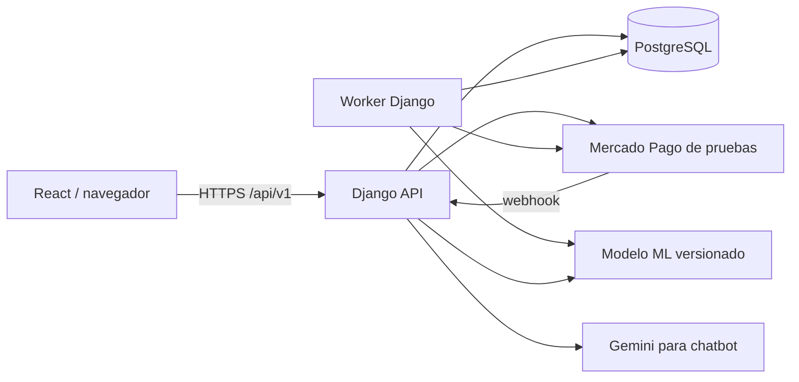

# Definición de proyecto DESSOF — arquitectura y programación

Versión 1.0 · 26 de octubre de 2026 · Estado: diseño técnico para implementación. Complementa [la definición funcional](definicion%20de%20proyecto%20DESSOF%20-%20funcional.md).

## 1. Arquitectura elegida

| Componente | Elección para prototipo | Responsabilidad |
| --- | --- | --- |
| Frontend | React existente + Vite | Catálogo, cesta, paneles y estados de operación; consume API. |
| Backend | Python 3.12, Django 5.2 LTS + Django REST Framework | Identidad, autorización, reglas, transacciones, API y administración. Fijar parches compatibles al instalar. |
| Datos | PostgreSQL 16 | Fuente de verdad, integridad, transacciones y bloqueos de inventario. |
| ML | pandas + scikit-learn | Generación sintética, entrenamiento, evaluación y predicción de demanda. |
| Pago | Mercado Pago Checkout Pro, familia Orders, credenciales de prueba | Checkout externo sin cobro real; adaptador aislado del dominio. |
| Chat | LangChain + `langchain-google-genai` + Gemini Developer API | Consultas estructuradas de solo lectura y filtradas por rol. Modelo inicial: `gemini-2.5-flash-lite`, sujeto a disponibilidad de la cuenta. |
| Tareas | Proceso worker Django + tabla de trabajos PostgreSQL | Conciliación de pagos, reservas y análisis diario. |
| Ejecución | Docker Compose local: `frontend`, `api`, `worker`, `db` | Entorno reproducible; publicación en nube opcional. |
| Pruebas | pytest/pytest-django, Playwright | Reglas, API, integración y recorrido del navegador. |

Se conserva y evoluciona `frontend/` del repositorio. Los antiguos `backend/main.py` y `database/schema.sql` eran marcadores vacíos y se retiraron. El proyecto Django vive en `backend/` y sus migraciones son la fuente del esquema. No se requiere microservicios, Redis ni reentrenamiento dentro de una petición web.



En desarrollo Vite usa proxy `/api` hacia Django. En la demo empaquetada ambos quedan bajo el mismo origen por proxy web; autenticación con sesión Django, cookie HttpOnly y CSRF para escrituras. El frontend nunca guarda tokens de Mercado Pago, costos secretos ni sesiones de pago en `localStorage`. `localStorage` puede conservar solo preferencias de interfaz no autoritativas.

## 2. Organización de código propuesta

```text
frontend/
  src/{api,auth,components,pages,features}/
backend/
  config/                  # settings, urls, ASGI/WSGI
  accounts/                # usuario, tienda, roles, sesiones
  catalog/                 # producto, lote, oferta, imágenes
  inventory/               # ingresos, ventas, merma, ajustes
  orders/                  # cesta validada, pedido, reserva
  payments/                # adaptador Checkout Pro y conciliación
  pricing/                 # políticas, límites, recomendaciones
  ml/                      # simulador, features, train, evaluate
  chat/                    # herramientas de lectura por rol
  audit/                   # eventos y decisiones
  jobs/                    # worker y tareas idempotentes
  tests/
```

Cada módulo separa modelos, servicios de negocio, permisos, serializadores y vistas. Vistas aceptan datos y llaman servicios; no modifican saldos directamente. El administrador de Django no es una vía para saltarse permisos de negocio o editar stock a mano.

## 3. Modelo de datos relacional

Convenciones: PK UUID; `created_at` UTC en todas las tablas; `updated_at` en editables; FKs con borrado restringido para historia. Cantidades `bigint` en unidad base; importes en `numeric(14,2)`/`Decimal`, costo proporcional interno `numeric(18,6)`; fechas `date`, instantes `timestamptz`. Presentación en `America/Lima`, moneda `PEN`. Índices en FKs, tienda, vencimientos, estados de reserva y trabajo. Las claves externas se validan con tienda y rol en servicio, además de constraints SQL posibles.

### 3.1 Identidad, catálogo e inventario

| Tabla | Campos centrales y restricciones |
| --- | --- |
| `Store` | nombre, dirección, horario, activo. Varias tiendas; información pública separada de datos internos. |
| `User` | email único sin distinguir mayúsculas, nombre, hash de contraseña Django, rol `ADMIN/OWNER/EMPLOYEE/CUSTOMER`, `store_id` opcional, activo. Owner/employee requieren tienda; admin/customer no. Índice parcial: un owner activo por tienda. |
| `Product` | `store_id`, código único por tienda, nombre, categoría, descripción, unidad `G/UNIT`, paso > 0, precio de referencia por paso > 0, conservación, foto opcional, activo. Unidad/paso no cambian tras movimientos: crear otro producto. |
| `Lot` | `product_id`, código único por producto, fecha_ingreso, fecha_vencimiento, cierre_venta, costo_total >= 0, cantidad_recibida > 0, físico >= 0, reservado >= 0, activo. `reservado <= físico`; fecha_vencimiento − fecha_ingreso >= 7 días para el catálogo demo. Cantidad es propia de cada lote. |
| `Offer` | `lot_id` único, estado `DRAFT/PUBLISHED/PAUSED/CLOSED`, precio_original_paso, precio_actual_paso, versión, pausa_automática. Precio actual > 0 y <= original. Una oferta por lote; publicarla fija referencia original. |
| `InventoryMovement` | `store_id`, `actor_id` opcional para venta web del sistema, tipo `INBOUND/LOCAL_SALE/WEB_SALE/WASTE/ADJUSTMENT`, estado, motivo, confirmado_en, `order_id` único opcional, referencia a corrección, clave idempotente y hash de solicitud. Confirmado es inmutable. |
| `MovementLine` | movimiento, lote, delta físico firmado no cero, precio aplicado por paso e importe opcionales, snapshot de unidad/versión. Una línea por lote en cada movimiento; un producto puede ocupar varios lotes. |

El stock disponible de lote es `physical_qty - reserved_qty`. El saldo materializado se actualiza solo mediante servicios transaccionales y se contrasta con movimientos/reservas en pruebas y diagnóstico. El costo por paso se deriva de costo total × paso / cantidad recibida. La creación de un lote deja saldo cero hasta confirmar su ingreso. Una corrección requiere motivo y movimiento compensatorio, no edición silenciosa.

### 3.2 Pedido, reserva y pago

| Tabla | Campos centrales y restricciones |
| --- | --- |
| `Order` | cliente, tienda, estado `PENDING/VERIFYING/PAID/FAILED/EXPIRED/PAYMENT_REVIEW`, total > 0, PEN, reserva_hasta, pagado_en, clave idempotente, hash de solicitud. Una tienda por pedido. |
| `OrderLine` | pedido, oferta/lote, cantidad_base > 0, paso_snapshot, precio_paso_snapshot, importe, vencimiento_snapshot y versión de oferta. Cantidad múltiplo del paso congelado. |
| `Reservation` | línea única, lote, cantidad_base > 0, estado `ACTIVE/CONSUMED/RELEASED`, expira_en, cerrada_en. Suma de reservas activas debe coincidir con `Lot.reserved_qty`. |
| `PaymentAttempt` | pedido, proveedor `MERCADOPAGO_TEST` (simulador solo para pruebas internas), referencia externa única, estado, importe/moneda, aprobado_en, clave de idempotencia al proveedor, respuesta resumida. |
| `PaymentEvent` | intento opcional, proveedor, ID externo único por proveedor, recurso externo, estado de procesamiento, payload **reducido**, código de error. Evento duplicado no crea otra venta. |

No guardar números de tarjeta, CVV ni tokens de tarjeta. Tres bodegas ficticias comparten una sola cuenta externa de vendedor de prueba; la separación financiera multivendedor no se implementa. Cliente de la aplicación y comprador externo de prueba son conceptos distintos; la guía actual de Checkout Pro Orders permite usar tarjeta de prueba sin cuenta compradora externa.

### 3.3 Precios, ML, trabajo y auditoría

| Tabla | Campos centrales y restricciones |
| --- | --- |
| `StorePricingPolicy` | tienda, versión, modo `REVIEW/AUTOMATIC`, desde/hasta, owner que autorizó. Solo una versión vigente por tienda; `REVIEW` inicial. |
| `OfferLimit` | oferta, versión, descuento_max_pct, precio_minimo_paso > 0, autorización_bajo_costo, owner y fechas de vigencia. Solo un límite vigente. |
| `MLModel` | versión, ruta privada/hash del artefacto, estado `EXPERIMENTAL/DEMO_VALIDATED/RETIRED`, versión de features/dataset, métricas, configuración y fecha de entrenamiento. |
| `AnalysisRun` | tienda, modelo, origen diario/manual, estado, fecha objetivo, clave de deduplicación y error. |
| `Recommendation` | análisis, oferta, versiones de oferta/política/límite, precio actual/propuesto, stock y predicciones congeladas, explicación, estado `KEEP/PENDING/APPLIED/REJECTED/STALE/ERROR`, decisor y fecha. |
| `PriceChange` | oferta, recomendación opcional única, anterior/nuevo, origen manual/automático, actor, motivo, versión de límite/modelo. Nuevo > 0 y <= anterior para cambios de descuento. |
| `Job` | tipo, clave única, payload mínimo, estado, disponible_en, lease_hasta, intentos, error. |
| `AuditEvent` | tienda opcional, actor opcional, acción, entidad/id, antes/después depurados, correlación_id. |

Precios, límites y política tienen historia versionada. El chatbot puede leer vistas/servicios filtrados, nunca tablas sin permisos. No se persisten conversaciones en el MVP.

## 4. Servicios y operaciones atómicas

| Servicio | Contrato principal |
| --- | --- |
| Inventario | `ingresar`, `vender_local`, `mermar`, `ajustar`; valida rol/tienda, paso, saldo y cierre. |
| Pedidos | `crear_y_reservar`, `consultar`, `liberar`; una tienda, precio congelado y reserva total o ninguna. |
| Pagos | `crear_checkout`, `recibir_evento`, `verificar`, `conciliar`; proveedor externo aislado. |
| Precios | `publicar`, `configurar_limites`, `cambiar_modo`, `decidir`, `aplicar`; revalida versiones y pisos. |
| Análisis | `preparar_features`, `evaluar_candidatos`, `recomendar`; no entrena al atender una petición. |
| Chat | `responder`; herramientas de lectura predeterminadas y filtradas por rol. |

### 4.1 Concurrencia de stock

Bloquear lotes afectados con `select_for_update` en orden de ID estable. `crear_y_reservar` valida pasos, tienda, oferta publicada, hora de cierre, precio y disponible; incrementa reservado y guarda pedido/líneas/reservas en **una transacción**. No llamar a Mercado Pago dentro del bloqueo SQL. Venta local bloquea los lotes elegidos, consume físico disponible y registra importe/movimiento juntos. Merma/ajuste no toca reservas activas. Repetir idempotency key con el mismo cuerpo devuelve el mismo recurso; con otro cuerpo devuelve conflicto.

### 4.2 Pago externo de prueba

1. Backend crea pedido y reserva; crea `PaymentAttempt` y solicita una `order` de Checkout Pro con token **de prueba**, `X-Idempotency-Key`, total y referencia interna. Devuelve URL de checkout a React.
2. Mercado Pago recibe los datos de tarjeta de prueba. React no interpreta parámetros de retorno como aprobación: consulta `GET /orders/{id}` del backend.
3. Webhook firmado o conciliador detecta cambio. El backend consulta el recurso externo autenticado y comprueba order, referencia, aplicación/cuenta, PEN, total exacto y estado aprobado. Payload de webhook por sí solo no es pago confirmado.
4. Bajo bloqueos, si reserva vigente y venta no existe, crea `WEB_SALE`, resta físico y reservado, consume reservas y marca `PAID` en un commit. Repetición devuelve el mismo estado.
5. Rechazo/expiración libera reserva solo tras verificar estado. Si resultado es incierto, `VERIFYING`; tras ventana técnica adicional inicial de 15 minutos sin confirmación, libera y mantiene incidencia visible. Aprobación posterior queda `PAYMENT_REVIEW` sin descontar otro stock.

La reserva inicial es 10 minutos o menos si el lote cierra antes. La venta se considera comercialmente recogida al marcar `PAID`; no se crea `DELIVERED`. Los casos técnicos `VERIFYING` y `PAYMENT_REVIEW` existen para que la demo no falsee pagos ni stock. No se implementa reembolso. La integración se prueba con aprobado, rechazado, duplicado, expirado y tardío, aunque el recorrido feliz use aprobación inmediata.

La cuenta debe permanecer en entorno **Prueba**; el backend rechaza credenciales/configuración de producción. La URL de webhook requiere HTTPS públicamente accesible (túnel temporal autorizado en local) o conciliación periódica mientras se desarrolla. La prueba de webhook se completa solo con endpoint público. No activar dinero real.

### 4.3 Aplicación de precios

`effective_floor = max(min_price, original_price × (1 - max_discount), cost_per_step si no hay permiso bajo costo)`, redondeado hacia arriba al céntimo. Candidato cumple `effective_floor <= new_price <= current_price` y `new_price > 0`. El dueño ajusta dentro de límites; si desea bajar más, modifica primero la política y deja auditoría. En automático se bloquea oferta y se cotejan versiones de precio, límite, política y disponibilidad. Una recomendación antigua se marca `STALE`, no se aplica. Un cambio manual pausa solo la oferta afectada. `KEEP` no produce un cambio ficticio.

Worker ejecuta análisis diario a las 02:00 America/Lima y permite análisis manual deduplicado. Un reinicio recupera trabajos pendientes por lease. La aplicación de precio, cambio de versión y auditoría ocurren en una transacción.

## 5. Contrato API inicial

Todas las rutas empiezan por `/api/v1`. JSON para datos y errores `{ "error": { "codigo": "...", "mensaje": "..." }, "correlacion_id": "..." }`. Sesión Django; CSRF obligatorio en escrituras autenticadas. Respuestas 401 sin sesión, 403 sin permiso, 404 fuera de alcance o inexistente, 409 conflicto de stock/versión/idempotencia, 422 datos inválidos, 503 dependencia externa. Paginación y filtros acotados en listas.

| Método/ruta lógica | Permiso y efecto |
| --- | --- |
| `GET /stores`, `GET /offers`, `GET /offers/{id}` | Público; solo campos de catálogo y disponibilidad publicables. |
| `POST /auth/login`, `POST /auth/logout`, `GET /auth/me` | Sesión y perfil; cookies, nunca contraseña en almacenamiento del navegador. |
| `POST /orders` | Cliente; ofertas/cantidades de una tienda + clave idempotente; calcula y reserva. |
| `POST /orders/{id}/checkout` | Cliente propietario; devuelve URL de prueba o intento existente. |
| `GET /orders/{id}` | Cliente propietario o personal autorizado; estado confirmado por servidor. |
| `POST /payments/webhook` | Proveedor; firma y procesamiento idempotente, sin sesión de cliente. |
| `GET /store/products`, `POST /store/products` | Personal consulta; dueño crea. |
| `GET /store/lots`, `POST /store/lots`, `POST /store/inbounds` | Consulta personal; escritura dueño. |
| `POST /store/local-sales`, `POST /store/waste`, `POST /store/adjustments` | Venta dueño/empleado; merma/ajuste dueño. |
| `GET /store/movements` | Personal de tienda; costo/importe según rol. |
| `POST /store/offers/{id}/publish`, `POST /store/offers/{id}/limits` | Dueño. |
| `GET /store/recommendations`, `POST /store/analysis`, `POST /store/recommendations/{id}/decision` | Lectura filtrada; ejecutar/decidir solo dueño. |
| `POST /store/pricing-policy` | Dueño, confirmación explícita de automático. |
| `POST /chat` | Usuario permitido, herramientas de solo lectura por rol. |
| `/admin/stores`, `/admin/users` | Administrador de plataforma, sin acceso automático a costos. |

Ejemplo `POST /orders`: `{"idempotency_key":"UUID","lines":[{"offer_id":"UUID","base_quantity":500}]}`. El cliente no envía total autorizado, tienda arbitraria ni precio. Un paso de 250 g produce dos unidades de precio por paso; servidor guarda snapshots.

## 6. Diseño de ML

### 6.1 Datos y entrenamiento

Generador reproducible separado de datos operativos: tres tiendas, 12 productos, 180 días, múltiples lotes, semilla 42 y pruebas de estrés con 43/44. Variar precio, interés del producto, día de semana, stock, vencimiento y respuesta al descuento; incluir productos poco sensibles y demanda baja. Etiqueta sintética: demanda diaria **latente** en pasos enteros, marcada como simulada. Ventas observadas pueden truncarse por stock: no confundirlas con demanda real. El simulador registra sus ecuaciones y parámetros ocultos; estos no entran como features.

Features: tienda/categoría, razón precio actual/original, días hasta cierre, stock en pasos, día de semana, edad de lote y ventas anteriores de 7/14 días disponibles en el momento. Si varios lotes comparten producto, repartir demanda por prioridad de vencimiento; no duplicarla en cada lote. Partición temporal 60/20/20, lotes sin cruzar cortes, prueba adicional con tienda/producto no vistos. Transformaciones ajustadas solo con entrenamiento.

Modelo inicial: `HistGradientBoostingRegressor` con pérdida Poisson y restricción monótona negativa sobre razón de precio, si la versión fijada de scikit-learn conserva esa capacidad. Entrenar y evaluar junto con predictor de media histórica y regla de descuentos por tramos. Guardar pipeline, orden/tipos de features, hash, dataset/semilla, parámetros y métricas. No reentrenar diariamente.

### 6.2 Decisión de descuento

Para cada precio en pasos iniciales de 1 punto porcentual desde actual hasta piso, más extremos exactos, estimar ventas hasta el cierre y limitar por pasos disponibles. Usar solo información anterior al instante del análisis. Cobertura = ventas esperadas / stock disponible en pasos, acotada a 100 %. Si precio actual cubre >=90 %, mantener. En otro caso elegir mayor precio que cubra >=90 %; si ninguno, mayor venta esperada y desempate por ingreso. Solo bajar si mejora cobertura >=5 puntos porcentuales; sin stock o datos suficientes, mantener e indicar motivo. Ponderar horas parciales del horario demo 08:00–20:00 como aproximación explícita.

Reporte: MAE de pasos/día, merma simulada, ingreso, margen, profundidad de descuento y cero violaciones de precio/stock. Comparar con mantener precio y regla de días restantes usando mismos escenarios/ruido. `DEMO_VALIDATED` requiere MAE no peor que media histórica, merma simulada no peor que mantener precio y ninguna violación; si falla queda `EXPERIMENTAL`, con automático deshabilitado. Esto valida solo la demo sintética, no eficacia comercial real. La explicación cita datos y predicciones guardadas, sin porcentaje de confianza inventado.

## 7. Chatbot

El backend ofrece herramientas cerradas: `list_public_offers`, `get_store_stock`, `get_store_sales`, `get_expirations`, `get_recommendation`. Inyecta tienda/usuario desde sesión; el modelo nunca elige una tienda ajena ni ejecuta SQL. Dueño puede ver costos propios; empleado no recibe costos o márgenes ni en JSON, herramientas, explicación o texto final; cliente solo datos públicos. Chatbot no tiene herramientas de escritura.

Gemini por API con clave solo en servidor. Configuración inicial: pregunta <=1000 caracteres, seis intervenciones efímeras, máximo tres llamadas a herramientas y tres al modelo, salida <=512 tokens por llamada, plazo total 30 s, límite cinco preguntas/minuto por usuario. Sin clave, cuota o servicio: error `CHAT_UNAVAILABLE`; navegación, inventario y pagos siguen operativos. No enviar datos personales reales en demo ni activar plan de pago automáticamente.

## 8. Frontend React

Reutilizar estructura, componentes y CSS aprovechables de `frontend/`; introducir cliente API tipado o documentado, manejo central de sesión, rutas por rol, estados de carga/error y datos de servidor. Retirar stock, precios, usuario y pedidos de `localStorage` como fuente de verdad. El catálogo puede verse anónimo; iniciar sesión antes de reservar/pagar. Mostrar importes y vencimientos por lote, paso de compra, disponibilidad y el aviso «pago de prueba». Después del retorno, consultar estado del backend hasta terminal o `VERIFYING`, sin mostrar pago aprobado solo por URL.

Panel del dueño: ingresos, lotes, costos, mermas/ajustes, límites, modo automático, recomendaciones, auditoría. Panel empleado: inventario, venta local, historial sin costos. Cliente: ofertas, cesta, pedidos y chat público. Administrador: cuentas/tiendas. Mantener accesibilidad básica, navegación por teclado y diseño móvil.

## 9. Seguridad, datos y operación

- Contraseñas con sistema Django; sesión HttpOnly, SameSite y `Secure` en HTTPS; CSRF en escrituras; autorización y filtro por tienda en servidor, nunca solo en React.
- Secretos en variables locales excluidas de Git: `DJANGO_SECRET_KEY`, `DATABASE_URL`, `MERCADOPAGO_TEST_ACCESS_TOKEN`, secreto de webhook, `GOOGLE_API_KEY`, `PUBLIC_BASE_URL`. No aceptar token de producción ni tarjetas reales.
- Fotos JPEG/PNG con validación de contenido, tamaño inicial máximo 5 MB y almacenamiento persistente privado con entrega controlada; sin foto de boleta/OCR.
- Registrar IDs de correlación, intentos, cambios y errores sin secretos o datos de tarjeta. Copia y restauración comprobada de base, fotos y modelo. Trabajos idempotentes, con reintentos acotados.
- Configuración inicial: `TIME_ZONE=America/Lima`, `CURRENCY=PEN`, `RESERVATION_MINUTES=10`, `RECONCILE_GRACE_MINUTES=15`, `ANALYSIS_TIME=02:00`, `ML_TARGET_COVERAGE=0.90`, `ML_MIN_GAIN_PP=5`.
- Versiones exactas y hashes de dependencias se fijan al crear entorno. Antes de integrar cuentas externas se verifica contrato vigente de API, credenciales, webhooks y cuota del proveedor.

## 10. Pruebas necesarias

1. Modelo/migraciones: constraints, dos lotes de tamaño diferente, ingreso antes de saldo, mínimo de duración de 7 días, unidad/paso y redondeo PEN.
2. Inventario PostgreSQL real: dos compradores por última unidad, web contra venta local, merma con reserva, transacciones y saldos nunca negativos.
3. Pago: aprobado, rechazado, incierto, expirado, tardío, evento duplicado/fuera de orden, retorno manipulado, firma inválida, moneda/importe erróneos y reinicio durante procesamiento.
4. Permisos: empleado sin costo/ajuste/precio; tienda ajena inaccesible; cliente sin datos privados; último administrador/dueño protegido.
5. Precio: piso, autorización bajo costo, modo revisión inicial, activación explícita, no aumento automático, cambio manual pausa lote, recomendación obsoleta y precio congelado de pedido.
6. ML: reproducibilidad, no fuga temporal, comparación de baselines, cero violaciones, reporte también de resultados desfavorables.
7. Chat: sin escritura, sin filtración, cuota/timeout, límites de herramientas y aislamiento de tienda.
8. Navegador: oferta → cesta → sesión → checkout de prueba → verificación backend → descuento stock → mensaje de recojo; React sin datos falsos persistentes.
9. Restauración: stock, reservas, pagos, precios, auditoría, fotos y modelo coinciden tras restaurar.

Las pruebas de reglas usan reloj inyectable y dobles de servicios externos. Una prueba de integración separada usa Mercado Pago realmente en entorno de prueba. No se marca el pago ni el chatbot como integrados por pasar solo pruebas con dobles.

## 11. Entregables por fase

| Fase | Entregable verificable |
| --- | --- |
| 1 | Migraciones, usuarios/tiendas y fixtures de 3 bodegas/12 productos con duración >=7 días. |
| 2 | API y React de inventario, lotes, ingresos, ventas locales, merma e historial. |
| 3 | Catálogo público, cesta, pedidos, reservas y pago externo de prueba con conciliación. |
| 4 | Generador/dataset, modelo entrenado, informe comparativo y recomendaciones. |
| 5 | Límites, activación explícita del modo automático y aplicación auditada. |
| 6 | Chatbot de solo lectura, pruebas integrales, instalación local y demostración. |

## 12. Referencias técnicas a revisar al implementar

- [Django 5.2 y compatibilidad Python](https://docs.djangoproject.com/en/5.2/releases/5.2/)
- [Mercado Pago Checkout Pro: crear order](https://www.mercadopago.com.pe/developers/es/docs/checkout-pro-orders/create-order)
- [Mercado Pago: credenciales de prueba](https://www.mercadopago.com.pe/developers/es/docs/checkout-pro-orders/create-application)
- [Mercado Pago: notificaciones](https://www.mercadopago.com.pe/developers/es/docs/checkout-pro-orders/notifications)
- [Mercado Pago: tarjetas de prueba](https://www.mercadopago.com.pe/developers/es/docs/checkout-pro-orders/integration-test/test-purchase-with-card)
- [scikit-learn: HistGradientBoostingRegressor](https://scikit-learn.org/stable/modules/generated/sklearn.ensemble.HistGradientBoostingRegressor.html)
- [Gemini API: precios y nivel gratuito](https://ai.google.dev/gemini-api/docs/pricing)
