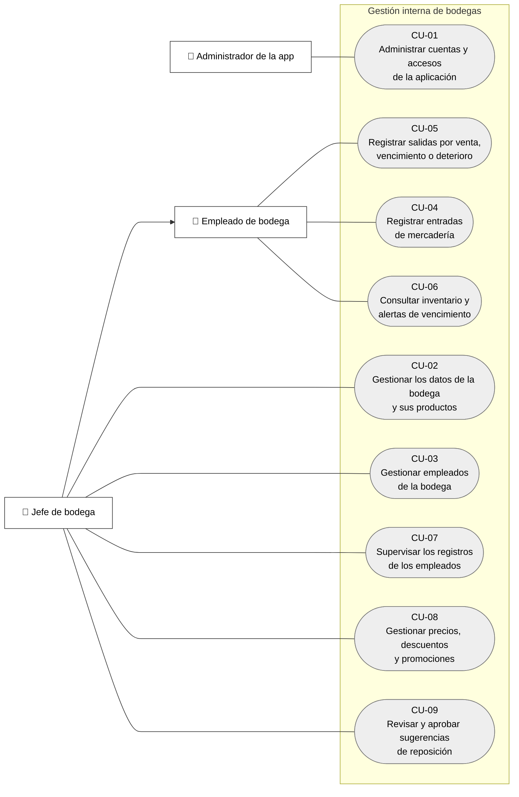

# Diagrama de casos de uso

La fuente explica que la generalización del jefe hacia el empleado significa que el jefe puede realizar sus funciones. Flowchart es una aproximación visual, no notación UML estricta.
