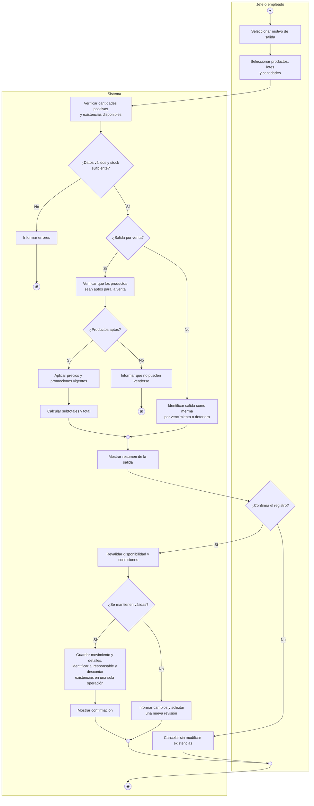

# Actividad CU-05 — Registrar salidas

El diagrama distingue venta y merma. La venta calcula total; la confirmación guarda movimiento, detalles, responsable y descuento de existencias. Cancelar o detectar error no produce salida parcial.
