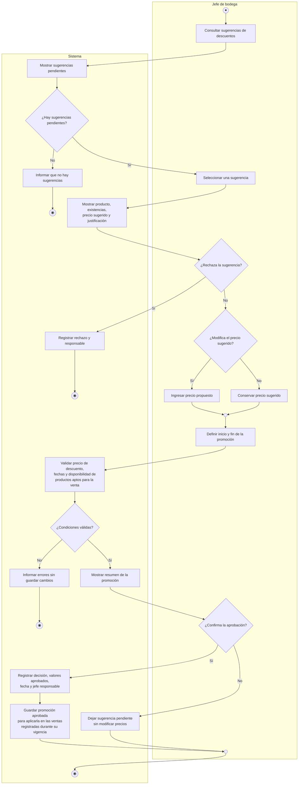

# Actividad CU-08 — Revisar y aprobar un descuento sugerido

Representa la variante de CU-08 que usa una sugerencia IA para aprobar una promoción interna. Las promociones manuales siguen validaciones comerciales equivalentes.
