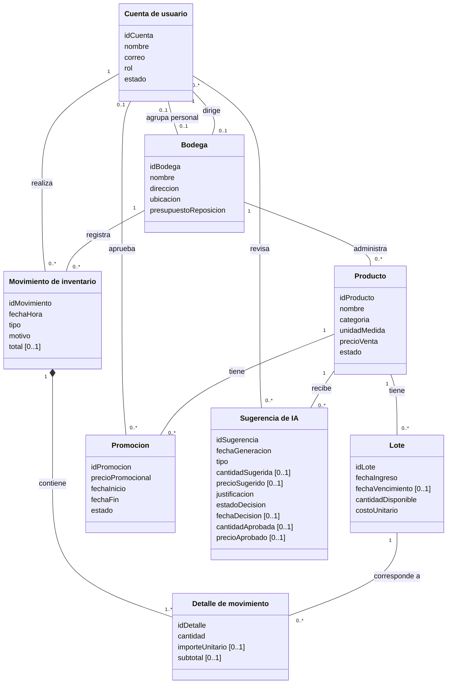

# Diagrama de clases del negocio

Se conservan las multiplicidades del README autocontenido. El diagrama es conceptual; no define tablas, claves foráneas, tipos SQL ni tecnología. La narrativa y las multiplicidades de personal/cuentas requieren reconciliación antes del diseño físico.
