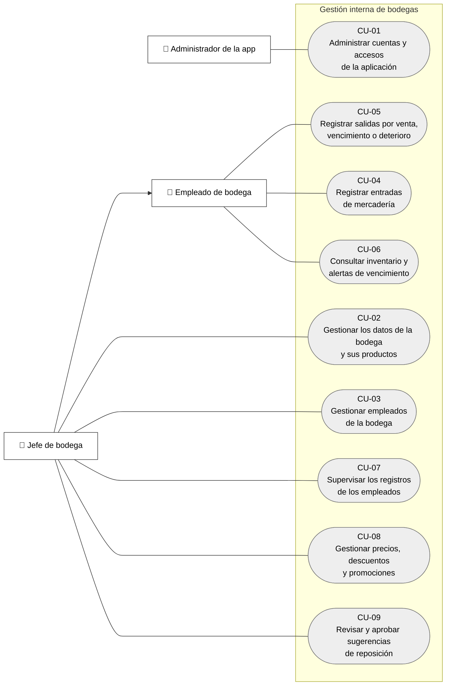
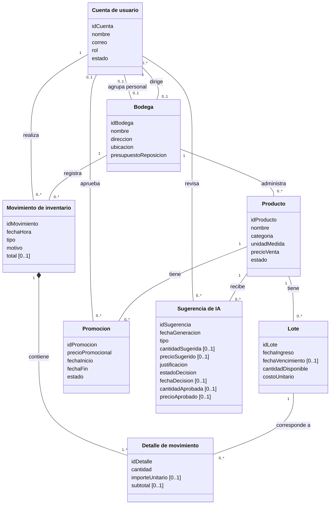
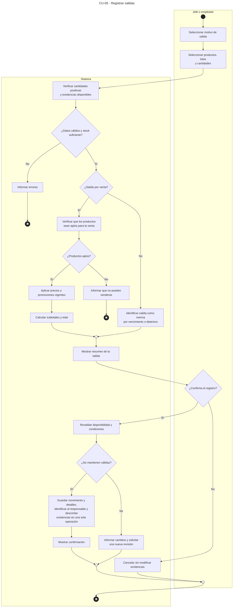
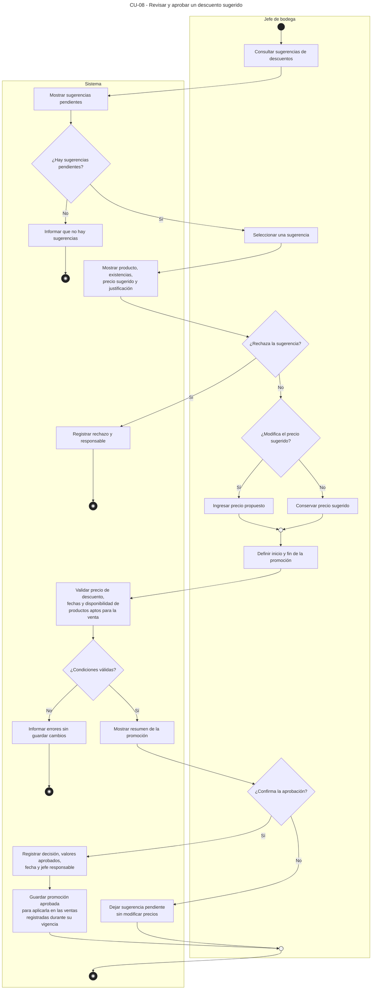

# Entregable 1 — Modelado del negocio

## Información general

| Campo | Información |
| --- | --- |
| Proyecto | Aplicación para la gestión interna de bodegas |
| Organización objetivo | Bodegas y minimarkets de barrio |
| Problema principal | Control poco estructurado de existencias y seguimiento de productos próximos a vencer. |
| Producto o servicio principal | Registro de inventario y ventas, supervisión de empleados y gestión interna de precios y promociones. |
| Curso | Diseño de Software |
| Grupo | 2 |
| Integrantes | Diaz Ysla, Walter Alexander; Champi Hinojosa, Miguel Angel; Cahuana Condori, Kelvin Andreí. |
| Sección | Pendiente de completar |
| Docente | Pendiente de completar |
| Fecha de entrega | Pendiente de completar |

## 1. Descripción de la organización objetivo

### 1.1. Organización y actividad

La organización objetivo es una bodega o minimarket de barrio dedicado a la venta minorista de productos de consumo cotidiano. El proyecto utiliza una bodega de referencia para describir su operación, sin atribuirle un nombre comercial ni presentar sus características como las de una empresa específica. La aplicación permitirá registrar diferentes bodegas, cada una con su propio catálogo, jefe y empleados.

El negocio pertenece al sector comercio. Ofrece productos a consumidores que compran para uso personal o familiar, incluyendo artículos envasados y productos perecibles. Su actividad cotidiana comprende organizar la mercadería, atender ventas, revisar cantidades disponibles y definir precios. La operación puede ser realizada por el dueño junto con familiares o empleados.

El jefe de bodega es el responsable de la gestión del establecimiento. Puede registrar las mismas operaciones que un empleado y, además, supervisar al personal y decidir precios, promociones y reposiciones. El administrador de la app es un rol diferente: controla las cuentas y accesos de la plataforma.

### 1.2. Situación actual y entrevistas exploratorias

Las entrevistas exploratorias realizadas permitieron identificar dificultades en el control de existencias y el seguimiento de vencimientos. La totalidad de los participantes consultados hasta esta etapa señaló las alertas de productos próximos a vencer como una función útil. Asimismo, se destacó la necesidad de un registro sencillo y rápido. Estos hallazgos orientan el alcance inicial del proyecto y se actualizarán conforme se incorporen nuevas entrevistas.

En las respuestas se describen prácticas como controlar el stock de memoria o en papel y registrar las entradas mediante apuntes o documentos de compra. El registro de ventas tampoco es uniforme: puede apoyarse en tickets, en la memoria o no realizarse. Esta situación dificulta reunir en un solo lugar las cantidades que ingresaron, las que salieron y las que siguen disponibles.

También se mencionan productos que no se venden y pérdidas por vencimiento. La participación de familiares y empleados introduce la necesidad de que el jefe pueda consultar quién realizó cada registro. Las entrevistas constituyen una aproximación inicial a estas necesidades; no demuestran todavía que la aplicación reduzca pérdidas ni que sus recomendaciones predictivas sean efectivas. Las respuestas originales se conservan en el [anexo de entrevistas](anexos/entrevistas_exploratorias.csv) o se muestra en la siguiente tabla.

| Pregunta | Respuesta 1 | Respuesta 2 | Respuesta 3 |
|---|---|---|---|
| **Submission Date** | sept 11, 2026 | sept 11, 2026 | sept 10, 2026 |
| **¿Qué tipo de negocio tiene?** | Minimarket | Bodega | Bodega |
| **¿Cuál es el principal problema que tiene actualmente para manejar su negocio?** | Pérdidas por frutas vencidas en diversas temporadas.  Proveedores no cambian productos vencidos. | No cambian los productos vencidos. Ejemplo:  Perdio 48 soles en una caja de Sublime. | Organizar la mercadería |
| **¿Cómo controla actualmente su stock?** | Cuaderno/papel | De memoria | De memoria |
| **¿Cómo decide los precios o descuentos de sus productos?** | Según el precio del proveedor | Comparando con otros puestos | Según el precio del proveedor |
| **¿Qué situaciones le generan más problemas? Elija hasta 3.** | Productos vencidos o deteriorados Cambios en el precio del proveedor Devoluciones o cambios | Productos que no se venden Productos vencidos o deteriorados Devoluciones o cambios | No saber cuánto stock tiene Productos que no se venden Cambios en el precio del proveedor |
| **¿Quiénes trabajan normalmente en el puesto?** | Dueño + empleados | Dueño + familiares | Dueño + familiares |
| **Si trabajan varias personas, ¿quién revisa o controla el stock, las ventas y los precios?** | Dueño/jefe | (Sin respuesta) | Dueño/jefe |
| **Cuando llega mercadería, ¿cómo registra lo que entra?** | Usa la boleta/factura como referencia | Cuaderno/papel | Cuaderno/papel |
| **Cuando vende un producto, ¿cómo registra lo que salió?** | Boleta o ticket | De memoria | No lo registra |
| **¿Qué información suele registrar o revisar?** | Precio de compra Precio de venta Fecha de ingreso Fecha de vencimiento Ganancia o margen | Precio de compra Precio de venta Proveedor Descuentos | Fecha de vencimiento |
| **¿Qué funciones le serían más útiles? Elija máximo 2.** | Alertas de productos próximos a vencer Sugerencias de precios y descuentos | Registrar ventas/boletas y descontar stock automáticamente Alertas de productos próximos a vencer | Control de stock Alertas de productos próximos a vencer |
| **¿Qué tendría que tener esta aplicación para que realmente la use?** | Fácil de usar, que reemplaze la labor del mercaderista, el cual viene mensualmente a realizar el seguimiento de productos y ofrecer nueva mercadería. Otras empresas tienen su aplicación como Coca Cola y Backus. | Facil de usar. Ya usa otras aplicaciones para hacer pedidos a proveedores como Coca Cola, Backus, etc. | Simplicidad |
| **¿Qué haría que no la use?** | Es complicada Toma demasiado tiempo registrar productos Necesita mucho Internet | Toma demasiado tiempo registrar productos | Es complicada |
| **Si existiera una versión sencilla que resolviera su principal problema, ¿estaría dispuesto a probarla durante una semana?** | Tal vez | Tal vez | Sí |

### 1.3. Procesos principales y problema

Los procesos comprendidos son el registro de entradas, el registro de salidas por venta o merma, la consulta de inventario y vencimientos, la supervisión del personal y la definición de precios y promociones. La compra y coordinación con proveedores quedan fuera del alcance. Una entrada representa el registro de mercadería que ya llegó al establecimiento.

El problema principal es la dificultad para mantener información organizada y actualizada sobre las existencias. Si una venta no se registra o no se revisan los vencimientos, el responsable puede desconocer cuánto queda o qué productos necesitan atención. La oportunidad consiste en reunir esa información mediante operaciones simples que puedan realizarse durante la atención diaria.

### 1.4. Solución propuesta y alcance del MVP

Se propone un producto mínimo viable (MVP) con tres roles: administrador de la app, jefe de bodega y empleado de bodega. El jefe y el empleado registrarán entradas y salidas con productos, lotes y cantidades. En las salidas por venta se calculará el total y se descontará el inventario una sola vez. Los retiros por vencimiento o deterioro se identificarán como merma.

El jefe podrá gestionar productos y empleados, revisar sus registros y establecer precios y promociones. Como apoyo, la IA propondrá cantidades de reposición o descuentos. El jefe podrá aprobar, modificar o rechazar cada sugerencia. Ninguna recomendación se aplicará por sí sola. Aprobar una reposición solo conservará una referencia interna; no generará una compra ni cambiará el inventario.

La aplicación será utilizada por el personal del establecimiento y el administrador de la app. Los precios y promociones se consultarán internamente y se utilizarán para registrar las ventas presenciales. No se incluye una vista pública ni acceso para compradores.

La primera versión excluye gestión de proveedores, pasarelas de pago, facturación electrónica, entregas, contabilidad y registro automático por voz o fotografía. No se estimará la vida útil mediante IA: se utilizarán las fechas de vencimiento registradas cuando correspondan. El pronóstico requiere datos de ventas; si no existen suficientes datos, el inventario y las consultas básicas seguirán disponibles sin presentar recomendaciones como si estuvieran validadas.

### 1.5. Resultado esperado

Se espera facilitar el registro de existencias, la supervisión del jefe y la identificación de productos que requieren revisión. La facilidad de uso y la utilidad de las sugerencias deberán evaluarse en pruebas posteriores. El objetivo de esta etapa es documentar una operación sencilla y coherente que sirva de base para los requisitos del MVP.

## 2. Actores del negocio y participantes

El alcance comprende la operación interna de las bodegas y la administración de cuentas de la plataforma. Se identifican tres roles que participan en los procesos cubiertos. Los roles internos que ejecutan actividades se detallan también como trabajadores en la sección 5.

| Código | Actor o participante | Tipo | Descripción e interacción |
| --- | --- | --- | --- |
| AN-01 | Administrador de la app | Interno a la plataforma | Mantiene cuentas, roles y estado de acceso. No sustituye al jefe de bodega. |
| AN-02 | Jefe de bodega | Interno a la bodega | Gestiona su establecimiento y empleados, supervisa registros y decide precios, promociones y reposiciones. |
| AN-03 | Empleado de bodega | Interno a la bodega | Registra entradas y salidas, calcula ventas mediante el registro y consulta existencias y alertas. |

No se incluye al proveedor como actor del alcance. La IA constituye una herramienta de apoyo, no un rol que autorice decisiones. Una cuenta de jefe puede ejecutar las funciones del empleado sin requerir una segunda cuenta.

## 3. Casos de uso

Los siguientes casos describen las operaciones comprendidas por el proyecto. CU-01 corresponde al soporte administrativo de la plataforma; los demás cubren la operación interna de la bodega. Se conserva la identificación CU-01 a CU-09 en todo el documento y los diagramas.

| Código | Caso de uso | Participante principal | Objetivo y resultado |
| --- | --- | --- | --- |
| CU-01 | Administrar cuentas y accesos de la aplicación | Administrador de la app | Mantener las cuentas y su estado de acceso a la aplicación. La cuenta se crea, actualiza, activa o desactiva según la operación confirmada. |
| CU-02 | Gestionar los datos de la bodega y sus productos | Jefe de bodega | Mantener los datos del establecimiento y su catálogo de productos. Los datos de la bodega o del producto quedan actualizados. |
| CU-03 | Gestionar empleados de la bodega | Jefe de bodega | Mantener la relación entre la bodega y sus empleados. El empleado queda incorporado o retirado de la bodega; sus registros anteriores se conservan. |
| CU-04 | Registrar entradas de mercadería | Empleado de bodega o jefe | Incorporar al inventario las cantidades de mercadería que ingresan. Se guarda la entrada con sus detalles y responsable; aumentan las existencias de los lotes correspondientes. |
| CU-05 | Registrar salidas por venta, vencimiento o deterioro | Empleado de bodega o jefe | Registrar las cantidades que salen del inventario e identificar su motivo. Se guarda una salida confirmada con sus detalles y responsable, y se descuenta el stock una sola vez. En una venta se guarda el total. |
| CU-06 | Consultar inventario y alertas de vencimiento | Empleado de bodega o jefe | Conocer las existencias y localizar lotes que requieren revisión por vencimiento. Se muestran existencias y fechas relevantes sin modificar el inventario. |
| CU-07 | Supervisar los registros de los empleados | Jefe de bodega | Revisar las entradas y salidas registradas por el personal. El jefe consulta los registros y sus responsables, sin alterarlos. |
| CU-08 | Gestionar precios, descuentos y promociones | Jefe de bodega | Establecer precios y aprobar promociones, con o sin apoyo de sugerencias de IA. Se guarda el precio o la promoción confirmada. Si se revisó una sugerencia, se conserva la decisión del jefe. |
| CU-09 | Revisar y aprobar sugerencias de reposición | Jefe de bodega | Apoyar la decisión interna de cuánto reponer, conservando el control del jefe. La decisión y cantidad aprobada quedan registradas. No se envía un pedido ni se incrementa el stock. |

## 4. Diagrama de casos de uso

<!--  -->

La generalización del jefe hacia el empleado indica que el jefe puede realizar las funciones de este último. Las asociaciones representan participación. No se incorporan relaciones include o extend porque no son necesarias para expresar los nueve casos definidos.

## 5. Trabajadores del negocio

| Código | Trabajador | Responsabilidad | Casos relacionados |
| --- | --- | --- | --- |
| TN-01 | Administrador de la app | Mantener las cuentas y accesos generales del servicio. | CU-01 |
| TN-02 | Jefe de bodega | Administrar su bodega y catálogo, incorporar o retirar empleados, supervisar registros, gestionar precios y decidir sobre sugerencias. También realiza las operaciones del empleado. | CU-02 a CU-09. |
| TN-03 | Empleado de bodega | Registrar entradas y salidas, y revisar existencias y vencimientos de su bodega. | CU-04, CU-05, CU-06 |

El administrador crea y mantiene la cuenta en la aplicación; el jefe gestiona su asignación a la bodega. Cada bodega tiene un jefe y puede tener varios empleados. Inicialmente, un jefe o empleado pertenece a una sola bodega. El administrador de la app no necesita estar asignado a un establecimiento.

## 6. Entidades del negocio

| Código | Entidad | Descripción | Atributos principales |
| --- | --- | --- | --- |
| EN-01 | Cuenta de usuario | Identifica al personal y al administrador de la app. | idCuenta, nombre, correo, rol, estado |
| EN-02 | Bodega | Establecimiento al que pertenecen el jefe, los empleados y los productos. | idBodega, nombre, dirección, ubicación, presupuestoReposicion |
| EN-03 | Producto | Artículo del catálogo de una bodega, con su unidad de medida y precio. | idProducto, nombre, categoría, unidadMedida, precioVenta, estado |
| EN-04 | Lote | Agrupa existencias de un producto ingresadas con un mismo costo y vencimiento, cuando este corresponda. | idLote, fechaIngreso, fechaVencimiento opcional, cantidadDisponible, costoUnitario |
| EN-05 | Movimiento de inventario | Registro de una entrada o salida. Una venta se representa como una salida con motivo venta. | idMovimiento, fechaHora, tipo, motivo, total opcional |
| EN-06 | Detalle de movimiento | Línea de un movimiento que identifica lote y cantidad; en ventas conserva el precio aplicado. | idDetalle, cantidad, importeUnitario opcional, subtotal opcional |
| EN-07 | Promoción | Precio rebajado de un producto durante un periodo definido. | idPromocion, precioPromocional, fechaInicio, fechaFin, estado |
| EN-08 | Sugerencia de IA | Recomendación por producto y decisión del jefe sobre reposición o descuento. | idSugerencia, fechaGeneracion, tipo, cantidadSugerida o precioSugerido, justificación, estadoDecision, fechaDecision, cantidadAprobada o precioAprobado |

El stock de un producto se obtiene sumando las cantidades disponibles de sus lotes. Cada detalle de movimiento corresponde a un lote. Si una venta utiliza varios lotes de un producto, se registran varias líneas dentro de la misma salida. Los importes de una venta quedan conservados en sus detalles aunque posteriormente cambie el precio del producto.

Las promociones corresponden individualmente a un producto; no se modelan paquetes combinados. Una sugerencia contiene una cantidad para reposición o un precio para descuento, según su tipo. La fecha y los valores de aprobación pueden estar vacíos mientras el jefe no haya tomado una decisión.

## 7. Detalle de los casos de uso

Las fichas presentan el flujo habitual, alternativas y situaciones que impiden completar una operación. El término «responsable» se refiere al jefe o empleado que realiza el registro. La aplicación valida y conserva la información; las autorizaciones comerciales corresponden al jefe.

### CU-01 — Administrar cuentas y accesos de la aplicación

| Elemento | Descripción |
| --- | --- |
| Nombre | Administrar cuentas y accesos de la aplicación |
| Código | CU-01 |
| Objetivo | Mantener las cuentas y su estado de acceso a la aplicación. |
| Actor o participante principal | Administrador de la app |
| Participantes secundarios | No requiere |
| Trabajador responsable | TN-01 |
| Precondiciones | El administrador tiene una cuenta activa y acceso a la gestión de cuentas. |
| Postcondiciones | La cuenta se crea, actualiza, activa o desactiva según la operación confirmada. |
| Entidades relacionadas | EN-01 |
| Reglas relacionadas | RN-01 |

#### Flujo principal

| Paso | Actor / trabajador / sistema | Acción |
| --- | --- | --- |
| 1 | Administrador | Consulta las cuentas existentes y selecciona crear o modificar una cuenta. |
| 2 | Administrador | Ingresa o actualiza nombre, correo, rol y estado. |
| 3 | Sistema | Comprueba que los datos requeridos estén completos. |
| 4 | Administrador | Confirma la operación. |
| 5 | Sistema | Guarda los datos y muestra el resultado. |

#### Flujos alternativos

| Código | Condición | Respuesta |
| --- | --- | --- |
| CU-01-FA-01 | Se desea retirar el acceso. | El administrador desactiva la cuenta. |
| CU-01-FA-02 | Se cancela la operación. | No se guardan los cambios. |

#### Excepciones

| Código | Situación | Respuesta |
| --- | --- | --- |
| CU-01-EX-01 | Faltan datos o el correo ya corresponde a otra cuenta. | Se informa el error y se solicita corregirlo. |
| CU-01-EX-02 | La cuenta que intenta operar no tiene permiso. | Se impide la modificación. |

### CU-02 — Gestionar los datos de la bodega y sus productos

| Elemento | Descripción |
| --- | --- |
| Nombre | Gestionar los datos de la bodega y sus productos |
| Código | CU-02 |
| Objetivo | Mantener los datos del establecimiento y su catálogo de productos. |
| Actor o participante principal | Jefe de bodega |
| Participantes secundarios | No requiere |
| Trabajador responsable | TN-02 |
| Precondiciones | El jefe tiene una cuenta activa y una bodega asignada. |
| Postcondiciones | Los datos de la bodega o del producto quedan actualizados. |
| Entidades relacionadas | EN-01, EN-02, EN-03 |
| Reglas relacionadas | RN-02, RN-07 |

#### Flujo principal

| Paso | Actor / trabajador / sistema | Acción |
| --- | --- | --- |
| 1 | Jefe | Accede a los datos de su bodega o a su catálogo. |
| 2 | Jefe | Selecciona agregar un producto o modificar información existente. |
| 3 | Jefe | Completa los datos de la bodega o el nombre, unidad y precio del producto. |
| 4 | Sistema | Valida los datos ingresados. |
| 5 | Jefe | Confirma los cambios. |
| 6 | Sistema | Guarda la información actualizada. |

#### Flujos alternativos

| Código | Condición | Respuesta |
| --- | --- | --- |
| CU-02-FA-01 | El producto deja de ofrecerse. | El jefe lo desactiva conservando los registros históricos. |
| CU-02-FA-02 | Se cancela la edición. | La información anterior permanece igual. |

#### Excepciones

| Código | Situación | Respuesta |
| --- | --- | --- |
| CU-02-EX-01 | Faltan datos obligatorios o el precio no es positivo. | Se solicita corregir los datos. |
| CU-02-EX-02 | Se intenta modificar otra bodega. | Se impide la operación. |

### CU-03 — Gestionar empleados de la bodega

| Elemento | Descripción |
| --- | --- |
| Nombre | Gestionar empleados de la bodega |
| Código | CU-03 |
| Objetivo | Mantener la relación entre la bodega y sus empleados. |
| Actor o participante principal | Jefe de bodega |
| Participantes secundarios | Empleado de bodega, como persona asignada. |
| Trabajador responsable | TN-02 |
| Precondiciones | El jefe tiene una bodega asignada. Para incorporar a una persona, su cuenta de empleado ya existe. |
| Postcondiciones | El empleado queda incorporado o retirado de la bodega; sus registros anteriores se conservan. |
| Entidades relacionadas | EN-01, EN-02 |
| Reglas relacionadas | RN-02 |

#### Flujo principal

| Paso | Actor / trabajador / sistema | Acción |
| --- | --- | --- |
| 1 | Jefe | Consulta la lista de empleados de su bodega. |
| 2 | Jefe | Selecciona una cuenta de empleado para incorporarla. |
| 3 | Sistema | Verifica el rol, estado y asignación de la cuenta. |
| 4 | Jefe | Confirma la incorporación. |
| 5 | Sistema | Asocia la cuenta a la bodega y actualiza la lista. |

#### Flujos alternativos

| Código | Condición | Respuesta |
| --- | --- | --- |
| CU-03-FA-01 | Se desea retirar a un empleado. | El jefe confirma el retiro y se elimina su acceso a esa bodega. |
| CU-03-FA-02 | La cuenta todavía no existe. | Su creación corresponde al administrador de la app mediante CU-01. |

#### Excepciones

| Código | Situación | Respuesta |
| --- | --- | --- |
| CU-03-EX-01 | La cuenta está inactiva, no es de empleado o pertenece a otra bodega. | Se informa la condición y no se realiza la asignación. |

### CU-04 — Registrar entradas de mercadería

| Elemento | Descripción |
| --- | --- |
| Nombre | Registrar entradas de mercadería |
| Código | CU-04 |
| Objetivo | Incorporar al inventario las cantidades de mercadería que ingresan. |
| Actor o participante principal | Empleado de bodega o jefe |
| Participantes secundarios | No requiere |
| Trabajador responsable | TN-03 o TN-02 |
| Precondiciones | El responsable tiene acceso a la bodega y los productos están registrados en el catálogo. |
| Postcondiciones | Se guarda la entrada con sus detalles y responsable; aumentan las existencias de los lotes correspondientes. |
| Entidades relacionadas | EN-01, EN-02, EN-03, EN-04, EN-05, EN-06 |
| Reglas relacionadas | RN-02, RN-03 |

#### Flujo principal

| Paso | Actor / trabajador / sistema | Acción |
| --- | --- | --- |
| 1 | Responsable | Selecciona registrar una entrada y los productos recibidos. |
| 2 | Responsable | Indica lote, cantidad y costo unitario; registra vencimiento cuando corresponda. |
| 3 | Sistema | Valida los datos y prepara el resumen de la entrada. |
| 4 | Responsable | Revisa y confirma el ingreso. |
| 5 | Sistema | Guarda el movimiento y sus detalles, e incrementa las cantidades disponibles. |

#### Flujos alternativos

| Código | Condición | Respuesta |
| --- | --- | --- |
| CU-04-FA-01 | El lote es nuevo. | Se registra el lote con sus datos de ingreso. |
| CU-04-FA-02 | El producto no tiene fecha de vencimiento aplicable. | La fecha queda sin valor. |
| CU-04-FA-03 | El responsable cancela. | No se registra la entrada ni se modifica el stock. |

#### Excepciones

| Código | Situación | Respuesta |
| --- | --- | --- |
| CU-04-EX-01 | El producto no existe en el catálogo. | El jefe debe registrarlo mediante CU-02 antes de continuar. |
| CU-04-EX-02 | Las cantidades no son positivas o faltan datos requeridos. | Se informa el error sin guardar el movimiento. |

### CU-05 — Registrar salidas por venta, vencimiento o deterioro

| Elemento | Descripción |
| --- | --- |
| Nombre | Registrar salidas por venta, vencimiento o deterioro |
| Código | CU-05 |
| Objetivo | Registrar las cantidades que salen del inventario e identificar su motivo. |
| Actor o participante principal | Empleado de bodega o jefe |
| Participantes secundarios | No requiere. |
| Trabajador responsable | TN-03 o TN-02 |
| Precondiciones | El responsable tiene acceso a la bodega y existen lotes registrados. |
| Postcondiciones | Se guarda una salida confirmada con sus detalles y responsable, y se descuenta el stock una sola vez. En una venta se guarda el total. |
| Entidades relacionadas | EN-01, EN-02, EN-03, EN-04, EN-05, EN-06, EN-07 |
| Reglas relacionadas | RN-02, RN-03, RN-04, RN-05, RN-06, RN-09 |

#### Flujo principal

| Paso | Actor / trabajador / sistema | Acción |
| --- | --- | --- |
| 1 | Responsable | Selecciona motivo, productos, lotes y cantidades de salida. |
| 2 | Sistema | Comprueba cantidades positivas y stock suficiente. |
| 3 | Sistema | Si es una venta, verifica los productos, aplica precios y promociones vigentes y calcula el total. |
| 4 | Sistema | Muestra un resumen de la salida. |
| 5 | Responsable | Confirma el registro. |
| 6 | Sistema | Revalida las condiciones y guarda movimiento, detalles y responsable junto con el descuento de existencias. |
| 7 | Sistema | Muestra la confirmación. |

#### Flujos alternativos

| Código | Condición | Respuesta |
| --- | --- | --- |
| CU-05-FA-01 | La salida es por vencimiento o deterioro. | Se registra como merma y no como venta; no se calcula un total de cobro. |
| CU-05-FA-02 | El responsable cancela. | No se guarda ni descuenta la salida. |

#### Excepciones

| Código | Situación | Respuesta |
| --- | --- | --- |
| CU-05-EX-01 | La cantidad es inválida o supera el stock. | Se informa el error y no se registra la salida. |
| CU-05-EX-02 | Se intenta vender un producto vencido o identificado como deteriorado. | Se impide la venta del producto. |
| CU-05-EX-03 | Las condiciones cambian antes de confirmar. | Se solicita revisar nuevamente la operación sin guardar una salida parcial. |

### CU-06 — Consultar inventario y alertas de vencimiento

| Elemento | Descripción |
| --- | --- |
| Nombre | Consultar inventario y alertas de vencimiento |
| Código | CU-06 |
| Objetivo | Conocer las existencias y localizar lotes que requieren revisión por vencimiento. |
| Actor o participante principal | Empleado de bodega o jefe |
| Participantes secundarios | No requiere |
| Trabajador responsable | TN-03 o TN-02 |
| Precondiciones | El responsable tiene acceso a su bodega. |
| Postcondiciones | Se muestran existencias y fechas relevantes sin modificar el inventario. |
| Entidades relacionadas | EN-01, EN-02, EN-03, EN-04 |
| Reglas relacionadas | RN-02, RN-04, RN-06 |

#### Flujo principal

| Paso | Actor / trabajador / sistema | Acción |
| --- | --- | --- |
| 1 | Responsable | Accede al inventario y busca un producto o consulta la lista. |
| 2 | Sistema | Muestra la cantidad disponible y sus lotes. |
| 3 | Responsable | Consulta los vencimientos del periodo que desea revisar. |
| 4 | Sistema | Destaca los lotes próximos a vencer dentro del periodo consultado y los ya vencidos. |
| 5 | Responsable | Revisa la información y decide si debe registrar una merma o comunicarla al jefe. |

#### Flujos alternativos

| Código | Condición | Respuesta |
| --- | --- | --- |
| CU-06-FA-01 | No hay resultados. | Se muestra una lista vacía. |
| CU-06-FA-02 | El lote no tiene vencimiento registrado. | Se muestra en inventario sin atribuirle una fecha estimada. |

#### Excepciones

| Código | Situación | Respuesta |
| --- | --- | --- |
| CU-06-EX-01 | Se solicita información de otra bodega sin permiso. | Se impide la consulta interna. |

### CU-07 — Supervisar los registros de los empleados

| Elemento | Descripción |
| --- | --- |
| Nombre | Supervisar los registros de los empleados |
| Código | CU-07 |
| Objetivo | Revisar las entradas y salidas registradas por el personal. |
| Actor o participante principal | Jefe de bodega |
| Participantes secundarios | Empleados, como autores de los registros. |
| Trabajador responsable | TN-02 |
| Precondiciones | El jefe tiene acceso a su bodega. |
| Postcondiciones | El jefe consulta los registros y sus responsables, sin alterarlos. |
| Entidades relacionadas | EN-01, EN-02, EN-03, EN-04, EN-05, EN-06 |
| Reglas relacionadas | RN-02, RN-03 |

#### Flujo principal

| Paso | Actor / trabajador / sistema | Acción |
| --- | --- | --- |
| 1 | Jefe | Abre la consulta de movimientos de su bodega. |
| 2 | Jefe | Selecciona un empleado o un periodo de fechas. |
| 3 | Sistema | Lista los movimientos con fecha, responsable y motivo. |
| 4 | Jefe | Selecciona un movimiento. |
| 5 | Sistema | Muestra productos, lotes, cantidades e importes cuando correspondan. |

#### Flujos alternativos

| Código | Condición | Respuesta |
| --- | --- | --- |
| CU-07-FA-01 | No existen registros para la selección. | Se muestra que no hay movimientos coincidentes. |

#### Excepciones

| Código | Situación | Respuesta |
| --- | --- | --- |
| CU-07-EX-01 | Un empleado intenta acceder a la supervisión reservada al jefe. | Se impide el acceso. |

### CU-08 — Gestionar precios, descuentos y promociones

| Elemento | Descripción |
| --- | --- |
| Nombre | Gestionar precios, descuentos y promociones |
| Código | CU-08 |
| Objetivo | Establecer precios y aprobar promociones, con o sin apoyo de sugerencias de IA. |
| Actor o participante principal | Jefe de bodega |
| Participantes secundarios | No requiere. |
| Trabajador responsable | TN-02 |
| Precondiciones | El jefe tiene acceso a su bodega y el producto está registrado. Para revisar una sugerencia, debe existir una pendiente. |
| Postcondiciones | Se guarda el precio o la promoción confirmada. Si se revisó una sugerencia, se conserva la decisión del jefe. |
| Entidades relacionadas | EN-01, EN-02, EN-03, EN-04, EN-07, EN-08 |
| Reglas relacionadas | RN-02, RN-06, RN-07, RN-08, RN-09 |

#### Flujo principal

| Paso | Actor / trabajador / sistema | Acción |
| --- | --- | --- |
| 1 | Jefe | Consulta las sugerencias pendientes y selecciona un descuento. |
| 2 | Sistema | Muestra producto, existencias, precio sugerido y justificación. |
| 3 | Jefe | Conserva o modifica el precio sugerido y define la vigencia. |
| 4 | Sistema | Valida el precio, las fechas y la disponibilidad de productos aptos; muestra el resumen. |
| 5 | Jefe | Confirma la aprobación. |
| 6 | Sistema | Guarda los valores aprobados, fecha y responsable, y crea la promoción. |
| 7 | Sistema | La utiliza al registrar ventas durante su vigencia, mientras exista stock apto disponible. |

#### Flujos alternativos

| Código | Condición | Respuesta |
| --- | --- | --- |
| CU-08-FA-01 | El jefe rechaza la sugerencia. | Se registra el rechazo sin modificar precios ni crear una promoción. |
| CU-08-FA-02 | Se cambia un precio o crea una promoción manualmente. | El jefe selecciona el producto e ingresa los valores; para promociones se aplican las mismas validaciones y confirmación. |
| CU-08-FA-03 | No hay sugerencias pendientes. | Se informa la ausencia; la gestión manual sigue disponible. |
| CU-08-FA-04 | El jefe cancela antes de confirmar. | No se guardan cambios; la sugerencia permanece pendiente. |
| CU-08-FA-05 | Se retira una promoción. | El jefe la desactiva y deja de aplicarse a las nuevas ventas. |

#### Excepciones

| Código | Situación | Respuesta |
| --- | --- | --- |
| CU-08-EX-01 | El precio o las fechas son inválidos, o no hay stock apto para la promoción. | Se informa el error sin guardar la promoción. |
| CU-08-EX-02 | Un empleado intenta modificar un precio o aprobar una promoción. | Se impide la operación. |

### CU-09 — Revisar y aprobar sugerencias de reposición

| Elemento | Descripción |
| --- | --- |
| Nombre | Revisar y aprobar sugerencias de reposición |
| Código | CU-09 |
| Objetivo | Apoyar la decisión interna de cuánto reponer, conservando el control del jefe. |
| Actor o participante principal | Jefe de bodega |
| Participantes secundarios | No requiere |
| Trabajador responsable | TN-02 |
| Precondiciones | El jefe tiene acceso a su bodega. Existen productos y, para revisarlas, sugerencias de reposición disponibles. |
| Postcondiciones | La decisión y cantidad aprobada quedan registradas. No se envía un pedido ni se incrementa el stock. |
| Entidades relacionadas | EN-01, EN-02, EN-03, EN-04, EN-05, EN-06, EN-08 |
| Reglas relacionadas | RN-02, RN-08 |

#### Flujo principal

| Paso | Actor / trabajador / sistema | Acción |
| --- | --- | --- |
| 1 | Jefe | Consulta las sugerencias de reposición. |
| 2 | Sistema | Muestra productos, existencias, cantidades sugeridas y justificación, considerando el historial disponible y el presupuesto registrado. |
| 3 | Jefe | Revisa la sugerencia y conserva o modifica la cantidad. |
| 4 | Jefe | Confirma su aprobación. |
| 5 | Sistema | Guarda la cantidad aprobada, fecha y responsable como referencia para la reposición. |

#### Flujos alternativos

| Código | Condición | Respuesta |
| --- | --- | --- |
| CU-09-FA-01 | El jefe rechaza una sugerencia. | Se guarda el rechazo sin generar acciones de compra. |
| CU-09-FA-02 | No hay historial suficiente o sugerencias disponibles. | Se informa la ausencia de recomendación; el inventario continúa funcionando. |
| CU-09-FA-03 | Se cancela la revisión. | La sugerencia permanece pendiente. |

#### Excepciones

| Código | Situación | Respuesta |
| --- | --- | --- |
| CU-09-EX-01 | Se intenta aprobar una cantidad no positiva. | Se solicita corregirla o rechazar la sugerencia. |
| CU-09-EX-02 | La cuenta no corresponde al jefe. | Se impide la aprobación. |

## 8. Diagrama de clases del negocio

<!--  -->

El diagrama es conceptual: muestra información, asociaciones y multiplicidades, sin definir tablas ni una tecnología de implementación. El símbolo 0..1 indica un valor o relación opcional; 0..* representa varios elementos posibles y 1..* exige al menos uno. El rombo lleno entre movimiento y detalle expresa composición: los detalles pertenecen al movimiento.

Cada bodega administra su catálogo, movimientos y personal. La relación «dirige» corresponde a una cuenta con rol de jefe. Esa cuenta también forma parte del personal de la misma bodega. Las relaciones «aprueba» y «revisa» están reservadas al jefe de la bodega correspondiente; pueden no tener responsable asignado mientras estén pendientes.

## 9. Diagramas de actividades

### 9.1. CU-05 — Registrar salidas

<!--  -->

El flujo distingue ventas y mermas. Las ventas aplican los precios vigentes y calculan el total. La confirmación registra el movimiento y actualiza existencias. Cancelar o detectar un error no produce una salida parcial. La aptitud del producto se determina con las fechas y la información registrada por el personal; no implica una inspección automática del estado físico.

### 9.2. CU-08 — Revisar y aprobar un descuento sugerido

<!--  -->

El diagrama representa la variante de CU-08 que utiliza una sugerencia de IA para aprobar una promoción de uso interno. El jefe puede rechazarla, conservar el precio o modificarlo antes de confirmar. Las promociones manuales siguen las mismas validaciones comerciales, sin pasar por la consulta de sugerencias.

## 10. Reglas de negocio

| Código | Regla | Tipo | Casos relacionados |
| --- | --- | --- | --- |
| RN-01 | El administrador de la app gestiona cuentas y accesos. | Autorización | CU-01 |
| RN-02 | El jefe gestiona su bodega y empleados y puede realizar las mismas operaciones que ellos. Cada empleado accede únicamente a su bodega. | Autorización | CU-02 a CU-09 |
| RN-03 | Toda entrada o salida debe indicar productos, lotes, cantidades positivas y responsable. | Validación | CU-04, CU-05, CU-07 |
| RN-04 | Una salida no puede superar las existencias disponibles. Al confirmarla, el stock se descuenta una sola vez. | Restricción | CU-05, CU-06 |
| RN-05 | El total de una venta es la suma de cantidad por precio aplicado de cada producto. | Cálculo | CU-05 |
| RN-06 | Los productos vencidos o registrados como deteriorados no pueden venderse; su retiro se registra como merma. | Restricción | CU-05, CU-06, CU-08 |
| RN-07 | Solo el jefe modifica precios y aprueba descuentos y promociones. | Autorización | CU-02, CU-08 |
| RN-08 | Las sugerencias de IA requieren aprobación del jefe, quien puede modificarlas o rechazarlas. Aprobar una reposición no genera una compra. | Autorización | CU-08, CU-09 |
| RN-09 | Una promoción debe tener un precio positivo menor al precio regular y una fecha final posterior a la inicial. Solo se aplica a las ventas mientras esté vigente y tenga stock apto disponible. | Validación | CU-05, CU-08 |

## 11. Matriz de trazabilidad

La matriz relaciona cada caso con sus participantes, responsables, entidades y reglas. Los códigos de entidades se desarrollan en la sección 6 y los de trabajadores en la sección 5.

| Caso | Actor / participante | Trabajador | Entidades | Reglas |
| --- | --- | --- | --- | --- |
| CU-01 | AN-01 | TN-01 | EN-01 | RN-01 |
| CU-02 | AN-02 | TN-02 | EN-01, EN-02, EN-03 | RN-02, RN-07 |
| CU-03 | AN-02; AN-03 como empleado asignado | TN-02 | EN-01, EN-02 | RN-02 |
| CU-04 | AN-02, AN-03 | TN-03 o TN-02 | EN-01, EN-02, EN-03, EN-04, EN-05, EN-06 | RN-02, RN-03 |
| CU-05 | AN-02, AN-03 | TN-03 o TN-02 | EN-01, EN-02, EN-03, EN-04, EN-05, EN-06, EN-07 | RN-02, RN-03, RN-04, RN-05, RN-06, RN-09 |
| CU-06 | AN-02, AN-03 | TN-03 o TN-02 | EN-01, EN-02, EN-03, EN-04 | RN-02, RN-04, RN-06 |
| CU-07 | AN-02 | TN-02 | EN-01, EN-02, EN-03, EN-04, EN-05, EN-06 | RN-02, RN-03 |
| CU-08 | AN-02 | TN-02 | EN-01, EN-02, EN-03, EN-04, EN-07, EN-08 | RN-02, RN-06, RN-07, RN-08, RN-09 |
| CU-09 | AN-02 | TN-02 | EN-01, EN-02, EN-03, EN-04, EN-05, EN-06, EN-08 | RN-02, RN-08 |

## 12. Evidencias y organización de archivos

Las entrevistas se utilizaron como exploración inicial del problema. La propuesta y los diagramas describen el alcance del MVP; no representan funciones ya implementadas ni resultados de una prueba de uso.

| Archivo | Contenido |
| --- | --- |
| README.md | Desarrollo del modelado, fichas de casos de uso, reglas y trazabilidad. |
| Modelado_Negocio.docx | Carátula y cuerpo del trabajo en formato Word. |
| img/diagrama_casos_uso_negocio.png | Roles y casos de uso. |
| img/diagrama_clases_negocio.png | Entidades, atributos y relaciones. |
| img/actividad_caso_uso_01.png | Flujo de registro de salidas. |
| img/actividad_caso_uso_02.png | Flujo de revisión de descuentos. |
| img/actividades_modelado_negocio.png | Esquema de actividades proporcionado en la consigna. |
| anexos/entrevistas_exploratorias.csv | Respuestas originales de las entrevistas. |

### Esquema de referencia de la consigna

<!--  -->

Actividades del modelado de negocio

| # | Actividad | # | Actividad |
|:-:|-----------|:-:|-----------|
| 1 | Describir la organización objetivo | 6 | Identificar entidades |
| 2 | Identificar actores del negocio | 7 | Detallar casos de uso |
| 3 | Identificar casos de uso | **8** | **Construir diagrama de clases** |
| 4 | Construir diagrama de casos de uso | **9** | **Construir diagrama de actividades** |
| 5 | Identificar trabajadores | **10** | **Declarar reglas de negocio** |
### Fuentes del trabajo

- Consigna «Entregable 1 — Modelado del negocio», proporcionada por el curso.
- «Propuesta de proyecto», documento del Grupo 2.
- «Modelado de negocio», avance inicial del equipo.
- Respuestas de las entrevistas exploratorias, conservadas en el anexo.

El alcance desarrollado en este documento corresponde a la versión ajustada del proyecto: tres roles, gestión interna de bodegas y sugerencias sujetas a decisión del jefe. Sustituye las funciones de versiones preliminares que quedaron fuera del MVP.
